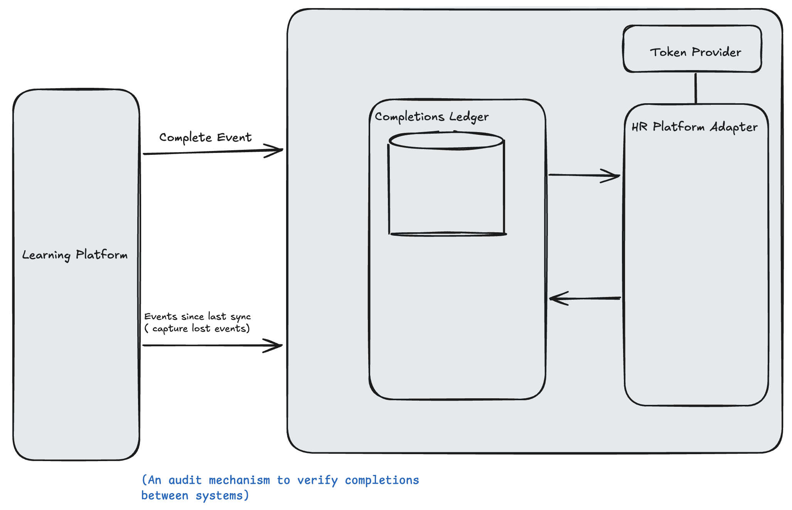
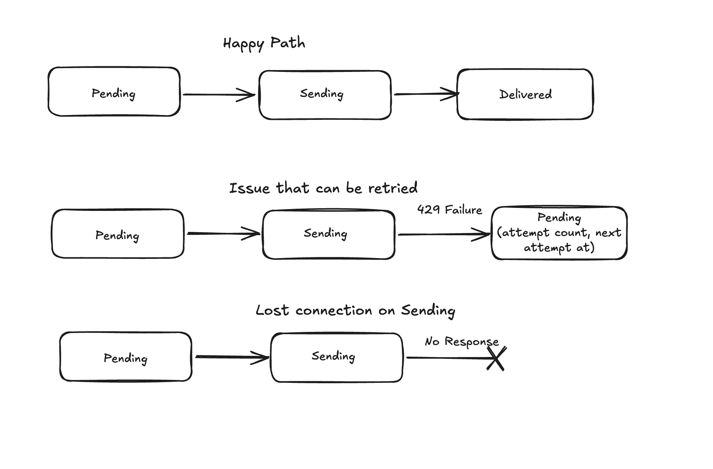

# Problem statement

## Context

We have a learning platform. Customers use it to train their people. Many customers keep their employee records in an HR platform.

Some of the integration exists already:
- A customer can make a connection to their HR platform.
- Each learner has an employee identifier from the HR platform.
- Administrators can make course mappings between our courses and HR certification types.

## The problem

When a learner completes a mapped course, the HR platform must show it. The completion must become a certification record on the matching employee.

## 
1. **The event can be lost.** The legacy platform sends an event when a learner completes a course. It doesn't send the event again if it fails. But no completion may be lost without someone knowing.
2. **The rate limit is low.** The HR platform accepts 100 requests per minute for each connection. In compliance season, one large customer can have more completions than that limit permits, so completions will wait.
3. **Retries can make duplicates.** A request can time out after the HR platform has already saved the record. If we send it again, we must not make a second certification record.
5. **History is necessary.** When a customer turns on sync, we must also send their earlier completions (backfill).
6. **Customer success must be able to see the result.** They must be able to answer "did this completion sync?" without an engineer.
 
## Delivery Slices
1. vertical slice implementing happy path for a completions event with a stubbed HR Platform adapter. (No auth or Send rate handling)
2. Failure handling to implement the different status flows. Stubbed HR Adaptor
3. Implement Send rate per customer using stubbed HR platform.
4. Implement the HR HTTP Adaptor
5. Implement Token Provider for HTTP Adaptor
6. Integrate HTTP Adaptor 
7. Migrate existing completion
8. Customer success view and alert
9. Feature flag by customer id

## Components

## Sync status flow

## Rejected options

- wiring directly to http API rather than going through Adapter. 
  - adapter pattern makes test stub implementation easier 
  - allow new adapter implementations for different HR systems

## Observability / alerts
- configure alerts component outages e.g DB
- logging
- alerts on unusual patterns (e.g. no completions for certain timeframe, high error counts )